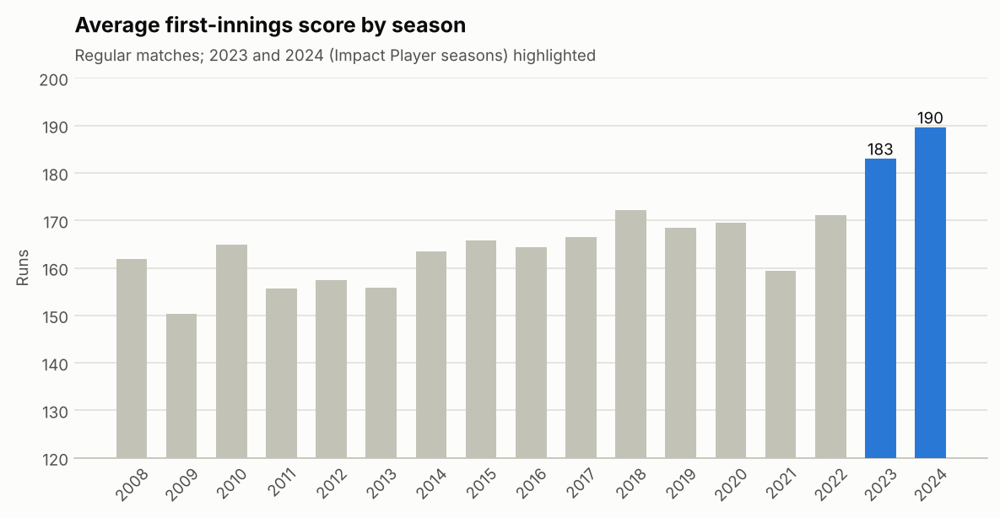
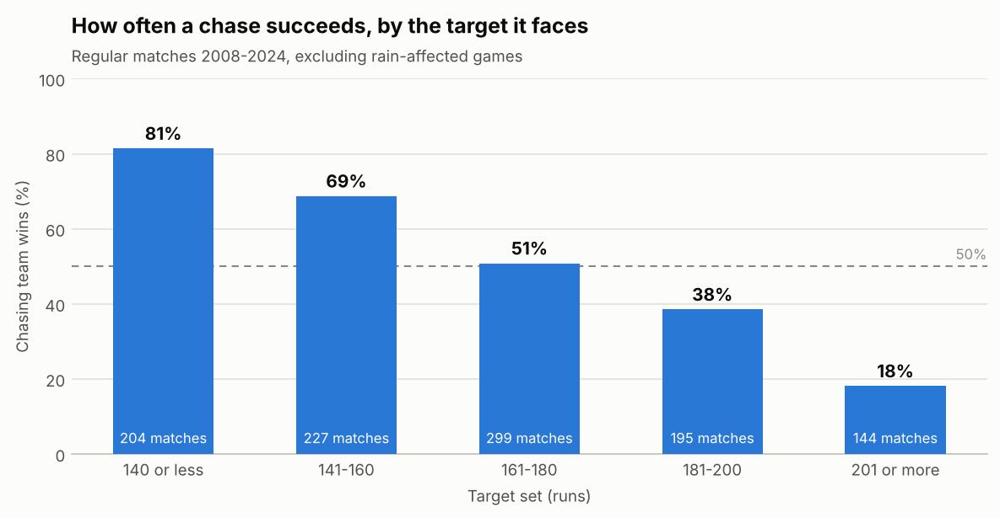
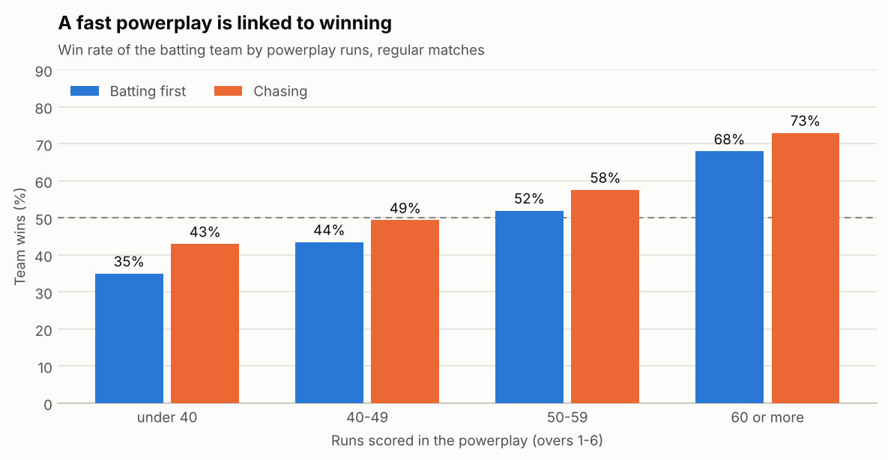
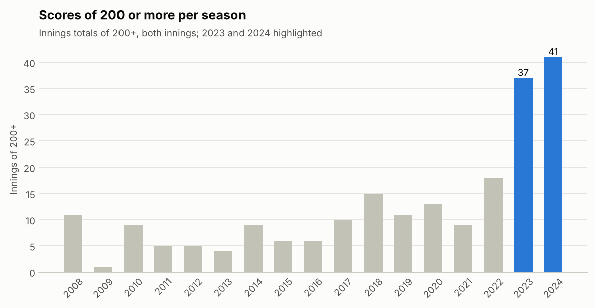
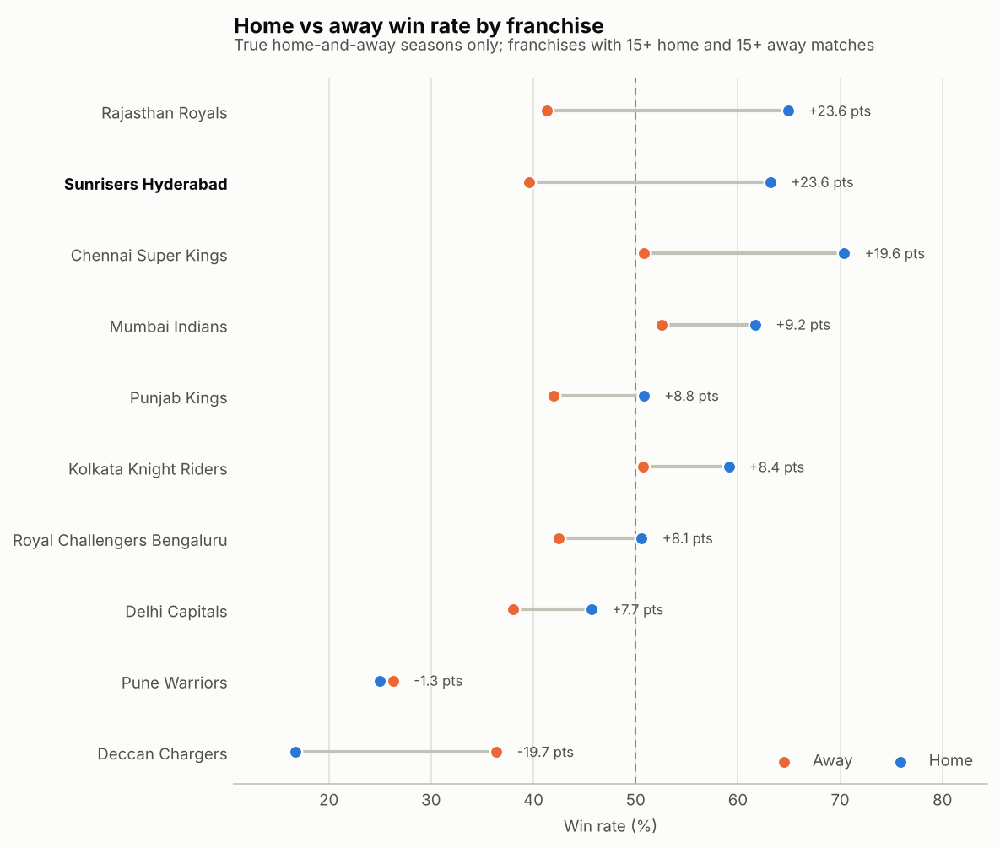
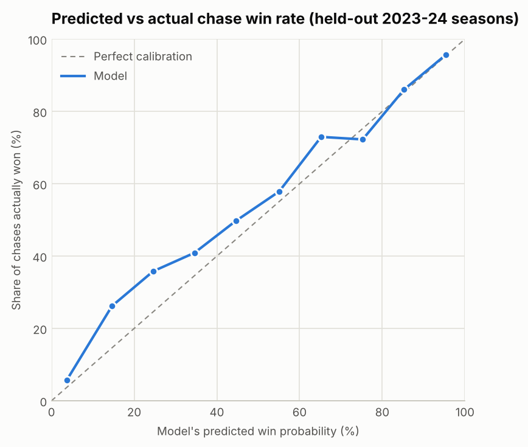

# IPL Analytics, 2008-2024

An end-to-end analysis of **1,095 IPL matches and 260,920 balls** (2008-2024): data cleaning and validation in Python, 20 SQL queries, hypothesis tests with confidence intervals, a chase win-probability model, and an interactive Streamlit dashboard.

**Live dashboard:** `https://YOUR-APP-NAME.streamlit.app`  <!-- replace after deploying, see "Deploy" below -->



## Questions and answers

Every number below comes from `results/findings.json` and `results/sql_results.md`, produced by the code in this repo. "CI" is a 95% Wilson confidence interval.

| Question | Finding |
|---|---|
| **Does winning the toss help?** | Barely. Toss winners won **50.8%** of 1,090 decided matches (CI 47.9-53.8%, p = 0.61 against 50%). Teams that chose to field won 53.9% (p = 0.045 against 50%) and teams that chose to bat 45.4% (p = 0.076), which is weak evidence, and the choice is not randomly assigned. |
| **Is chasing easier?** | A little, historically: chasing teams won **54.1%** (CI 51.2-57.1%). The edge depends on the target: **81%** of chases succeed against a target of 140 or less, **51%** at 161-180, and only **18%** at 201 or more (144 matches). |
| **Has T20 scoring changed?** | Yes, sharply. Average first-innings score rose from **163.0** (2008-22) to **186.3** (2023-24), Welch t-test p = 2e-12. First innings of 200+ went from 10.2% to **34.5%** of all first innings. The seasons covered are the first two with the Impact Player rule, but this analysis does not isolate the rule from other changes. |
| **Did the chasing edge disappear after 2023?** | Chasing teams won 55.1% in 2008-22 and 47.9% in 2023-24. With only 144 recent matches the difference is **not statistically significant** (Fisher exact p = 0.13). |
| **Does a fast powerplay go with winning?** | Strongly. Teams batting first won 35% of the time with under 40 powerplay runs and **68%** with 60 or more. Chasing teams went from 43% to **73%**. This is an association, not proof that the powerplay causes the win. |
| **Is there a home advantage?** | Yes, modest: home teams won **55.0%** (CI 51.2-58.7%, n = 671, p = 0.011) in the seasons played in a true home-and-away format. |
| **What about Hyderabad?** | Sunrisers Hyderabad won **63.2%** at Uppal and 39.6% away (Fisher p = 0.022). Deccan Chargers, the earlier Hyderabad franchise, won only 3 of 18 there. The ground itself is not unusual: 163.8 average first-innings score vs 166.2 elsewhere, and chasing teams win 54.7% there vs 53.7% elsewhere. |

Team-level home/away tests (SRH, Deccan, CSK, RR) were chosen after looking at the data and are not corrected for multiple comparisons, so treat them as descriptive.

<p>
 
</p>
<p>
 
</p>

## Chase win-probability model

At the end of any over of a chase, what is the chasing team's chance of winning? A logistic regression on five features (runs needed, balls left, wickets lost, required run rate, current run rate), trained on 2008-2022 and tested on the unseen 2023-24 seasons (142 chases, 2,548 over-by-over states).

| Model | AUC | Brier score (lower is better) |
|---|---|---|
| Always predict the historical chase win rate | 0.500 | 0.253 |
| Rule of thumb: favour the side needing under 8 an over | 0.690 | 0.209 |
| **Logistic regression (shipped)** | **0.869** | **0.150** |
| Gradient boosting (compared) | 0.868 | 0.150 |

A more complex model added nothing, so the simple, explainable one ships, with its coefficients stored as JSON so the dashboard predicts with plain NumPy. Accuracy rises through the chase: AUC 0.80 in overs 1-6, 0.85 in overs 7-12 and 0.93 in overs 13-19.



Limits: the model ignores who is batting and bowling, the pitch and dew. On 2023-24 it was a little too pessimistic about chasing teams (the calibration line sits above the diagonal at the low end), because it learned from lower-scoring seasons. States from the same match are correlated, so the real uncertainty is closer to 142 independent chases than 2,548.

## Data work

Raw files: `matches.csv` and `deliveries.csv`. `src/prepare_data.py` cleans them and checks the result:

- 58 venue spellings merged into **36 grounds**; renamed franchises merged (Delhi Daredevils to Delhi Capitals, Kings XI Punjab to Punjab Kings, Royal Challengers Bangalore to Bengaluru), while Deccan Chargers, Gujarat Lions, Pune Warriors and Kochi stay separate because they are different franchises.
- The raw season labels are inconsistent (`2007/08`, `2009/10`, `2020/21`), so the season is taken from the match date.
- 161 super-over deliveries excluded; 5 no-result and 21 Duckworth-Lewis matches kept out of scoring statistics; retired-hurt is not counted as a wicket (15 cases).
- 28 overs showed a seventh legal ball because a no-ball was not tagged in the raw data; they are capped at 6.
- **Validation:** the ball-by-ball totals reproduce the official target in **1,069 of 1,069** regular matches and the official run margin in **486 of 486** matches won by runs.
- Home advantage is only measured in true home-and-away seasons (2008, 2010-19, 2023-24). 2009 (South Africa), 2020 (UAE), 2021 (bubble venues) and 2022 (Maharashtra only) had no real home games.

## SQL

`sql/ipl_queries.sql` holds 20 queries (CTEs, window functions `LAG`, `RANK`, rolling averages, `UNION ALL`, `HAVING`). They run against SQLite tables built from the cleaned data, and every result table is written to `results/sql_results.md`. Examples: 3-season rolling chase win rate, season-on-season change in scoring with `LAG`, venue rankings, home vs away win rate per franchise, death-over bowlers by economy.

## Dashboard

`app.py` is a four-tab Streamlit app: **Overview** (trends with a season filter), **Teams & grounds** (home/away split with confidence intervals, ground guide), **Players** (batters and bowlers by phase of the innings) and **Chase predictor** (enter any chase state, or replay a real match over by over).

## Run it yourself

```bash
pip install -r requirements-analysis.txt
# put matches.csv and deliveries.csv in data/raw/
python src/prepare_data.py       # clean + validate -> data/processed/
python src/run_analysis.py       # SQL + statistics + figures -> results/, figures/
python src/train_win_model.py    # model -> models/, results/model_metrics.json
streamlit run app.py             # dashboard
```

The processed CSVs and the trained model are committed, so `streamlit run app.py` works without the raw files.

## Deploy

1. Push this repo to GitHub.
2. Go to [share.streamlit.io](https://share.streamlit.io), sign in with GitHub, choose **Create app**, pick this repo, branch `main`, main file `app.py`.
3. Deploy, then paste the app URL into the "Live dashboard" line at the top of this README.

## Repo layout

```
app.py                     Streamlit dashboard
ipl_utils.py               cleaning rules, home-ground table, Wilson CI, model inference
ipl_charts.py              all charts (one colour system for README and dashboard)
src/prepare_data.py        raw -> clean tables + validation
src/run_analysis.py        SQL, statistical tests, figures
src/train_win_model.py     chase win-probability model
sql/ipl_queries.sql        the 20 SQL queries
data/processed/            cleaned tables (committed)
models/win_model.json      model coefficients
results/                   sql_results.md, findings.json, model_metrics.json
figures/                   charts used above
```

## Limitations

- Observational data: associations (powerplay and winning, fielding first and winning) are not causes.
- 2023-24 is only 142 matches, so conclusions about the newest era are less certain than the earlier ones.
- Phases are fixed at overs 1-6, 7-15 and 16-20; Impact Player substitutions are not modelled.
- The win model uses match state only, with no player, pitch or weather information.
